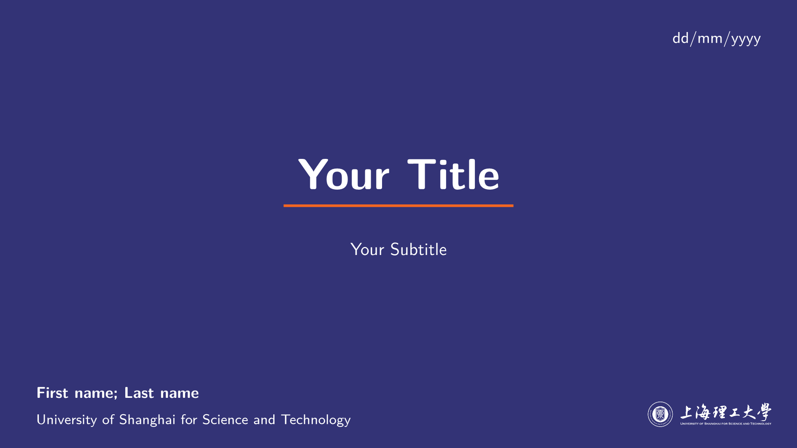
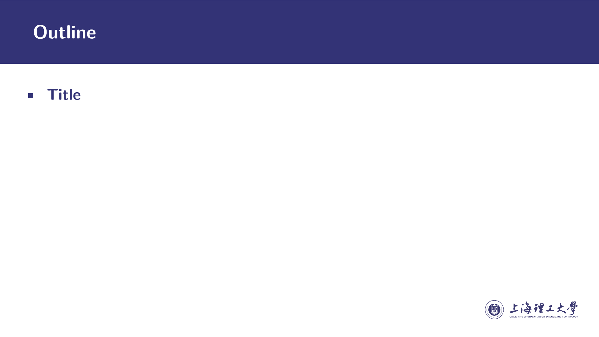
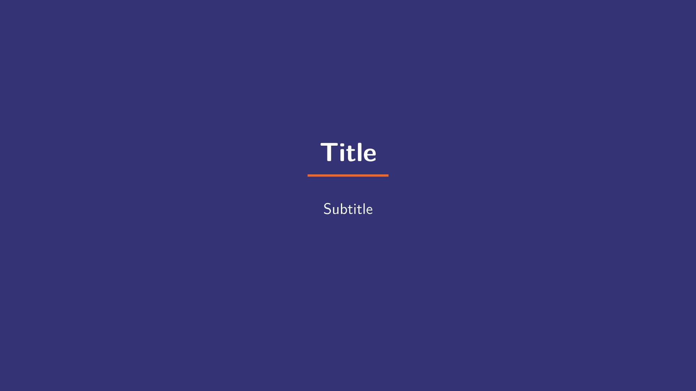
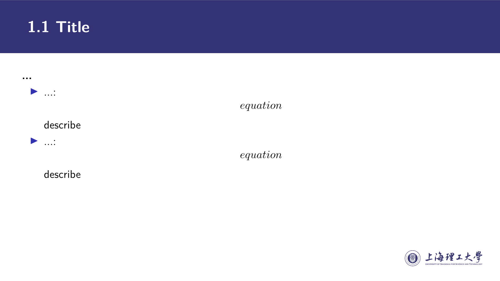
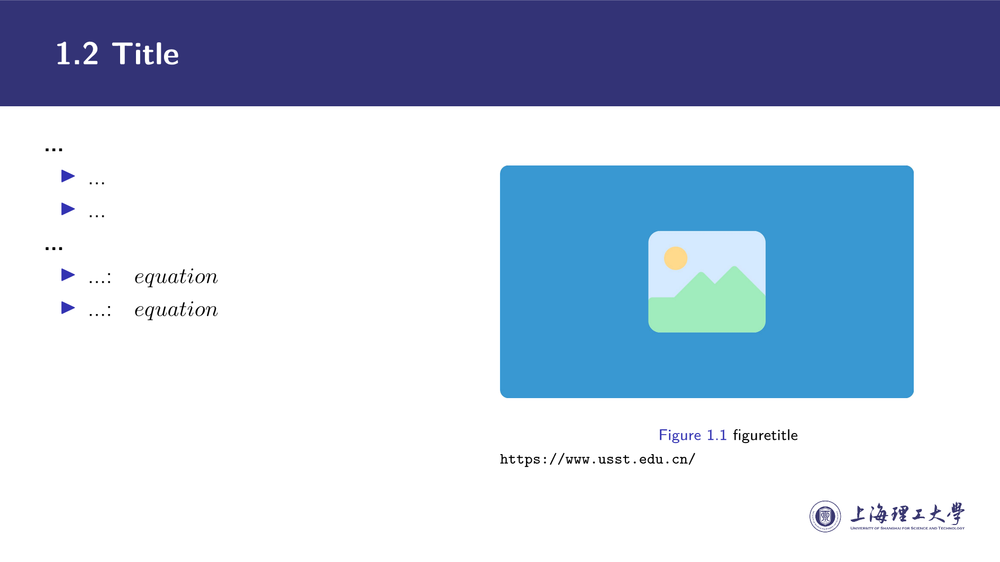
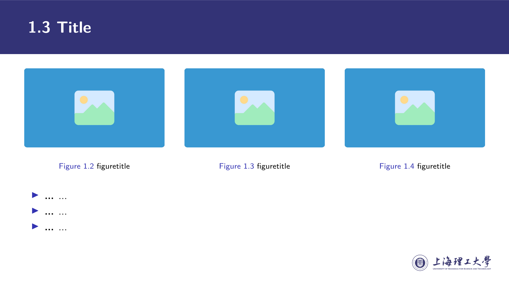
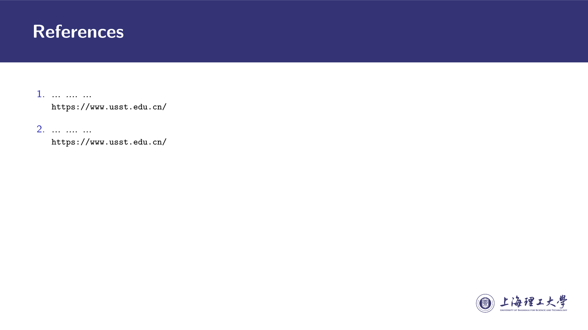

# USST Academic Beamer Template (LaTeX)

这是一份专为**学术汇报、组会展示**设计的 LaTeX Beamer 幻灯片模板。基于 DataIA Institute 的开源模板深度定制，适配了上海理工大学（USST）的主题配色与视觉风格。

---

## ⚠️ 开源溯源与致谢 (Acknowledgements)

本模板的设计灵感与底层结构基于 **DataIA Institute (Université Paris-Saclay)** 所开发的开源模板。
在此对原作者表示诚挚的感谢！如需了解原版模板，请访问：
*   **官方来源**: [https://www.dataia.eu/en/node/1618](https://www.dataia.eu/en/node/1618)
*   **原版 Overleaf 链接**: [Template slide [ENGL]](https://www.overleaf.com/latex/templates/template-slide-engl/fbnvwwqbvktm)

> **修改说明**：本模板在原版基础上，更换了底部 Logo，添加了 USST 专属主题色，并针对学术汇报中常用的“图文并排”、“多图对比”、“参考文献”等场景制作了即插即用的版式模板。

---

## ✨ 模板特性 (Features)

*   **学术适配**：16:9 宽屏比例，提供单栏公式、双栏图文、三图对比等多种科研常用排版。
*   **品牌定制**：采用 USST 群青主色 (`#0F1F7A`) 搭配亮橙强调色。
*   **自动编号**：内置 `\contentTitle` 宏，可实现 `章节号.页码`（如 1.1, 1.2）的自动页眉编号。
*   **清晰注释**：源码中包含详尽的中文注释，特别标注了如何调整图片大小、间距和位置。

---

## 📸 预览图 (Preview)

<!-- 封面单独一排，宽度设为 60% 显得更突出 -->
<p align="center">
  
</p>

<details>
  <summary>👉 点击展开查看全部排版预览 (共 6 页)</summary>
  <br>
  <!-- 第 1 组：两两一排 -->
<p align="center">
  
  &nbsp;&nbsp;&nbsp;
  
</p>

<!-- 第 2 组：两两一排 -->
<p align="center">
  
  &nbsp;&nbsp;&nbsp;
  
</p>

<!-- 第 3 组：两两一排 -->
<p align="center">
  
  &nbsp;&nbsp;&nbsp;
  
</p>
</details>

---

## 🚀 快速开始 (Quick Start)

### 1. 环境要求
本模板使用了 `fontspec` 等宏包，**必须使用 XeLaTeX 引擎进行编译**。使用 pdfLaTeX 会导致直接报错无法生成 PDF。

### 2. 在 Overleaf 中使用 (推荐)
1. 将本仓库下载为 `.zip` 格式（或 `git clone` 至本地后打包）。
2. 登录 Overleaf，点击 `New Project` -> `Upload Project`，上传你的 zip 文件。
3. **关键步骤**：点击左上角的 `Menu`，在 `Compiler` 选项中，将默认的 pdfLaTeX 更改为 **XeLaTeX**。
4. 点击 `Recompile` 即可成功编译。

### 3. 本地使用 (VS Code / TeXstudio)
*   **VS Code**: 确保安装了 LaTeX Workshop 插件。建议在此项目文件夹下新建 `.vscode/settings.json`，写入 `{"latex-workshop.latex.recipe.default": "latexmk (xelatex)"}` 以强制使用 XeLaTeX 编译。
*   **TeXstudio**: 在 `选项` -> `设置 TeXstudio` -> `构建` 中，将默认编译器改为 `XeLaTeX`。

---

## 🛠️ 自定义修改指南 (Customization)
在 main.tex 中，我已将全局配置和多种页面样式进行了模块化分类，你可以通过搜索 % 【修改指南】 快速定位需要调整的地方。

### 1. 替换个人与会议信息
在代码 **第 2 节** 修改元数据宏：
```latex
\newcommand{\presTitle}{Your Title}
\newcommand{\presSubtitle}{Your Subtitle}
\newcommand{\presAuthor}{First name; Last name}
\newcommand{\presRole}{University of Shanghai for Science and Technology}
\newcommand{\presDate}{dd/mm/yyyy}
```

### 2. 更改主题颜色 (非 USST 用户)
```latex
\definecolor{USSTblue}{cmyk}{1,1,0.3,0}     % 主色
\definecolor{USSTorange}{cmyk}{0,0.75,1,0}  % 强调色
```

### 3. 调整排版间距与大小 (进阶)
模板中预留了详细的中文注释，教你如何微调：
调整正文左右边距：修改 \setbeamersize{text margin left=0.7cm, text margin right=0.7cm}。
调整图片大小：修改 \includegraphics[width=\textwidth, height=0.42\textheight, ...] 中的 height 数值。
调整标题栏高度：修改 \fill[USSTblue] ... ([yshift=-1.7cm] ...) 中的 1.7cm，同时记得修改下方的 \vspace{1.7cm} 保持一致。
调整元素位置：通过修改 xshift（水平偏移）和 yshift（垂直偏移）的正负数值来实现。
*提示：在 Markdown 代码块（``` 之间的内容）中，可以完美嵌套 LaTeX 的代码块，GitHub 渲染时会自动高亮显示，非常美观。*

---

## 📂 文件目录结构

```text
├── main.tex                # 核心主文件（在此修改内容）
├── README.md               # 本说明文档
├── LICENSE                 # 开源许可证文件
└── Image/                  # 图片资源文件夹
    ├── Image_default.png   # 占位图片
    ├── USST_Logo_(0,0,0,0).png     # 深色背景用 Logo
    └── USST_Logo_(1,1,0.3,0).png   # 浅色背景用 Logo
